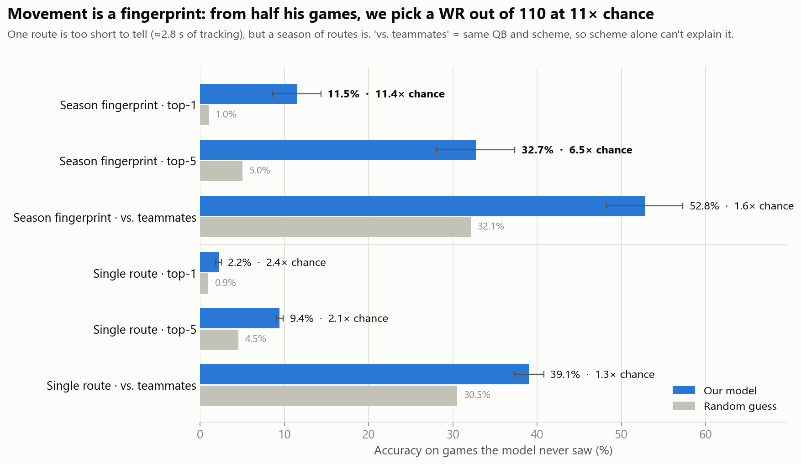
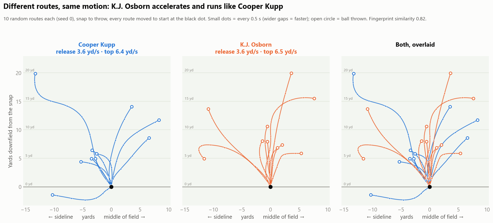

# WR SHADOW

**Who moves like whom, and who does it for less in case of injury.** Movement fingerprints for NFL wide receivers, built from 2021 Next Gen Stats tracking data.

**🌐 Website:** https://chirantan2003.github.io/shadow/ · **📓 Notebook:** [`demo.ipynb`](demo.ipynb)

## Problem, solution, what we made

- **Problem:** Scouts compare receivers by eye ("he moves like Cooper Kupp"), and when a star is too expensive or gets hurt, there is no measurable way to find who can move the same way for less, keeping the team training and strategy intact.
- **Solution:** Turn every route into movement-only numbers (release, top speed, braking, cuts, path straightness), average them into a 28-number fingerprint per WR, and compare fingerprints with cosine similarity, excluding teammates.
- **What we made:** A fingerprint for 110 receivers (18,053 routes, 2021 weeks 1–8), a doppelgänger finder, a budget-replacement table using public 2021 salaries, and a website to explore it all.
- **Insight:** Movement style is a real, measurable trait: from half of a receiver's games we pick him out of 110 at **11× chance** in his other half, driven mostly by his release and top speed.
- **Assumptions and limits:** Only 8 weeks of passing plays, tracking ends at the throw, most doppelgänger lists are not stable across the season (only 5 pairs are), and salary comes from public nflverse/OverTheCap contracts, which miss fifth-year options.
- **Who uses it:** Scouts and GMs looking for cheaper replacements, coaches picking a backup who runs a hurt starter's role the same way, and broadcasters ("this rookie moves like Davante Adams").



**Two different players, same motion.** Cooper Kupp ($15.8M) and K.J. Osborn ($0.9M) run different routes, but release and accelerate the same way:



## Key results

| Finding | Result |
|---|---|
| Identify a WR from half his games (out of 110) | 11.5% vs 1.0% chance (**11×**) |
| Same test, among his own teammates only | 52.8% vs 32.1% chance (1.6×) |
| Stable doppelgänger pairs (other teams) | 5, e.g. Justin Jefferson → Henry Ruggs |
| Best budget doppelgänger | Cooper Kupp ($15.8M) → K.J. Osborn ($0.9M): similar movement and build, **$14.9M/yr saved** |

## Repo

| Path | What's there |
|---|---|
| [`demo.ipynb`](demo.ipynb) | Runs the whole pipeline end to end, with charts |
| [`src/`](src) | `load_data` → `features` → `fingerprint` → `doppelganger` → `budget` → `visuals` → `website` |
| [`outputs/`](outputs) | Every chart and CSV (fingerprints, doppelgängers, budget table) |
| [`docs/`](docs) | The website (GitHub Pages) |
| [`OUT_OF_REPO.md`](OUT_OF_REPO.md) | How to get the data and reproduce everything |

## Run it

```bash
python3 -m venv .venv && .venv/bin/pip install -r requirements.txt
git clone --depth 1 https://github.com/ThompsonJamesBliss/nfl-big-data-bowl-regional-event-data.git data
.venv/bin/jupyter nbconvert --to notebook --execute demo.ipynb --output demo.ipynb
```

Data: [NFL Big Data Bowl regional event data](https://github.com/ThompsonJamesBliss/nfl-big-data-bowl-regional-event-data) (Next Gen Stats, PFF) · Contracts and injuries: [nflverse](https://github.com/nflverse/nflverse-data)
